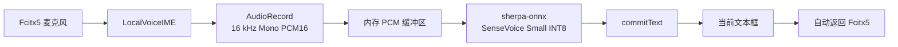

# LocalVoiceIME

LocalVoiceIME 是一个完全离线运行的 Android 本地语音输入法，面向
[Fcitx5 for Android](https://github.com/fcitx5-android/fcitx5-android) 及其 RIME
Plugin 使用场景。

在 Fcitx5 中点击麦克风后，系统切换到 LocalVoiceIME。用户完成录音后，应用在
手机本地使用 sherpa-onnx 和 SenseVoice Small INT8 识别语音，将结果提交到当前
文本框，然后自动切回 Fcitx5。

> 录音和语音识别不会上传到云端。当前实现不包含任何语音上传接口。

## 当前功能

- Android `InputMethodService` 语音输入法
- 可被 Fcitx5 麦克风按钮识别的 `voice` subtype
- 16 kHz、单声道、PCM 16-bit 本地录音
- 后台线程读取音频，不阻塞输入法 UI
- sherpa-onnx Android 1.13.4
- SenseVoice Small INT8 本地中英文混合识别
- 自动语言检测和逆文本归一化
- 识别结果通过 `InputConnection.commitText()` 输入当前文本框
- 识别成功后自动切回上一个输入法（通常是 Fcitx5）
- “返回小企鹅键盘”手动切换按钮
- 60 秒单次录音上限
- 输入目标变化保护，避免将迟到结果提交到错误文本框
- 仅构建 `arm64-v8a` APK

## 工作流程



所有音频处理和模型推理均在 Android 设备本地完成。

## 环境要求

- macOS、Linux 或 Windows
- Android Studio
- Android SDK
- JDK 11 或更高版本（推荐使用 Android Studio 内置 JBR）
- Android 8.0（API 26）或更高版本
- ARM64 Android 手机
- Fcitx5 for Android；如需 RIME，可另外安装 RIME Plugin

项目当前配置：

- Kotlin
- Gradle Kotlin DSL
- Min SDK 26
- Target/Compile SDK 37
- ABI：`arm64-v8a`

## 下载 SenseVoice 模型

模型文件体积较大，因此不会提交到 Git。构建前需要下载一次官方模型包。

模型来源：

- [sherpa-onnx SenseVoice 文档](https://k2-fsa.github.io/sherpa/onnx/sense-voice/pretrained.html)
- [官方模型压缩包](https://github.com/k2-fsa/sherpa-onnx/releases/download/asr-models/sherpa-onnx-sense-voice-zh-en-ja-ko-yue-int8-2024-07-17.tar.bz2)

下载并校验：

```bash
curl -L --fail \
  -o /tmp/sensevoice-int8.tar.bz2 \
  "https://github.com/k2-fsa/sherpa-onnx/releases/download/asr-models/sherpa-onnx-sense-voice-zh-en-ja-ko-yue-int8-2024-07-17.tar.bz2"

shasum -a 256 /tmp/sensevoice-int8.tar.bz2
```

预期 SHA-256：

```text
7d1efa2138a65b0b488df37f8b89e3d91a60676e416f515b952358d83dfd347e
```

将模型和词表解压到 Android assets：

```bash
mkdir -p app/src/main/assets/sense-voice

tar -xjf /tmp/sensevoice-int8.tar.bz2 \
  -C app/src/main/assets/sense-voice \
  --strip-components=1 \
  sherpa-onnx-sense-voice-zh-en-ja-ko-yue-int8-2024-07-17/model.int8.onnx \
  sherpa-onnx-sense-voice-zh-en-ja-ko-yue-int8-2024-07-17/tokens.txt
```

完成后应存在：

```text
app/src/main/assets/sense-voice/model.int8.onnx
app/src/main/assets/sense-voice/tokens.txt
```

参考大小：

```text
model.int8.onnx  约 228 MB
tokens.txt       约 308 KB
Debug APK        约 264 MB
```

这两个文件已被 `.gitignore` 排除，不应通过普通 Git 提交。

## 构建

在 Android Studio 中打开项目并等待 Gradle 同步，然后运行：

```bash
./gradlew :app:testDebugUnitTest :app:assembleDebug
```

如果 macOS 终端没有配置 Java，可以使用 Android Studio 内置 JBR：

```bash
JAVA_HOME="/Applications/Android Studio.app/Contents/jbr/Contents/Home" \
  ./gradlew :app:testDebugUnitTest :app:assembleDebug
```

生成的 APK 位于：

```text
app/build/outputs/apk/debug/app-debug.apk
```

## 安装

通过 USB 或无线 ADB 连接手机后执行：

```bash
adb devices
adb install -r app/build/outputs/apk/debug/app-debug.apk
```

如果 `adb` 不在 `PATH` 中，macOS 默认 SDK 路径通常为：

```bash
~/Library/Android/sdk/platform-tools/adb install -r \
  app/build/outputs/apk/debug/app-debug.apk
```

安装后不会出现普通桌面启动图标，这是正常现象：LocalVoiceIME 是输入法服务，
不是带主界面的普通 App。

## 启用和使用

1. 进入 Android 系统的“语言与输入法”或“管理屏幕键盘”设置。
2. 启用“本地语音输入”。
3. 将 Fcitx5 设为日常使用的输入法。
4. 打开任意文本框，点击 Fcitx5 工具栏中的麦克风。
5. 系统切换到 LocalVoiceIME 后，等待状态显示“SenseVoice Small INT8 已就绪”。
6. 点击“开始录音”并说话。
7. 点击“停止录音”。
8. 等待本地推理完成，识别文字会自动写入当前文本框。
9. 成功输入后，系统自动返回 Fcitx5。

首次录音时，Android 会要求授予麦克风权限。权限页面会明确说明音频仅在本地
处理。

## 隐私与安全

- 不上传录音
- 不调用云端语音识别 API
- 不把 PCM 音频保存到文件
- 录音数据仅暂存在进程内存中
- 输入法隐藏或切换时会停止录音并释放 `AudioRecord`
- 识别前会检查模型状态
- 识别结果提交前会检查输入目标是否仍然有效

请注意：输入法本身能够读取和提交当前文本框内容。只应安装自己构建或可信来源
提供的 APK。

## 项目结构

```text
app/src/main/
├── AndroidManifest.xml
├── assets/sense-voice/
│   ├── README.md
│   ├── model.int8.onnx    # 本地文件，Git 忽略
│   └── tokens.txt         # 本地文件，Git 忽略
├── java/com/example/localvoiceime/
│   ├── MicrophonePermissionActivity.kt
│   ├── PcmSampleBuffer.kt
│   ├── SenseVoiceAsr.kt
│   └── VoiceInputService.kt
└── res/xml/method.xml
```

## 已知限制

- 当前 APK 只包含 `arm64-v8a` 原生库，不支持 x86 模拟器和 32 位手机。
- SenseVoice Small 是非流式模型：停止录音后才开始完整识别。
- 单次录音最长 60 秒。
- 模型随 APK 打包，因此安装包较大。
- Fcitx5 的麦克风能切换到 LocalVoiceIME，但 LocalVoiceIME 无法接收 Fcitx5
  键盘内部的空格按下/松开事件。
- “长按 Fcitx5 空格录音、松开识别且键盘不切换”需要修改并自行维护
  Fcitx5 Android，当前项目不实现该功能。
- 不同 Android ROM 对输入法历史记录的处理可能不同；如果无法直接返回上一个
  输入法，应用会打开系统输入法选择器。

## 开发路线

- [x] M1：Voice IME 骨架、Fcitx5 集成、`commitText()`
- [x] M2：`AudioRecord` 16 kHz Mono PCM16
- [x] M3：sherpa-onnx + SenseVoice Small INT8
- [x] M4：录音、后台推理、自动提交文字
- [ ] M5：OpenCC 繁体转简体
- [ ] M6：中英文专业术语修正
- [ ] M7：Silero VAD
- [ ] 设置界面与 Release APK

## 第三方项目

- [sherpa-onnx](https://github.com/k2-fsa/sherpa-onnx)
- [SenseVoice](https://github.com/FunAudioLLM/SenseVoice)
- [Fcitx5 for Android](https://github.com/fcitx5-android/fcitx5-android)
- [RIME](https://rime.im/)

使用和分发前，请分别确认应用代码、sherpa-onnx、SenseVoice 模型及其他第三方
组件的许可证要求。
